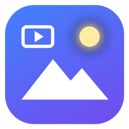

<p align="center"></p>

<h1 align="center">Lumen</h1>
<p align="center"><b>A fast, private, modern image and video viewer for Windows: a FastStone Image Viewer replacement with a built-in video analysis mode.</b><br>
One portable <code>Lumen.exe</code> or a small installer. No admin rights, no account, no telemetry.</p>

<p align="center"><a href="https://github.com/RahulTarigoppula/lumen-image-viewer/releases/latest"><b>Download Lumen</b></a></p>

---

## Why Lumen

FastStone Image Viewer is loved for being fast and complete, but it shows its age: a dated UI, tiny previews inside modal edit dialogs, no real video support and no way to remap keys. Lumen keeps what makes FastStone great (the browser and viewer workflow, keyboard-first operation, batch tools) and rebuilds it on a modern, GPU-accelerated engine:

- **Instant on huge images.** A tiled GPU renderer with a mip pyramid shows 100+ megapixel photos and pans and zooms smoothly. Neighbours are preloaded, so stepping through a folder is instant. Folders with thousands of files browse at under 1 ms per frame.
- **Many formats.** JPEG, PNG/APNG, GIF (animated), WebP (animated), TIFF (multi-page), BMP, ICO/CUR, TGA, PNM, QOI, DDS, HDR, OpenEXR, PSD/PSB, SVG, PCX, WMF/EMF and PDF pages natively; HEIC/HEIF, AVIF, JPEG XL, JPEG-XR and camera RAW (DNG, CR2/CR3, NEF, ARW, ORF, RW2, RAF and more) through Windows codecs.
- **Correct color.** Embedded ICC profiles (Adobe RGB, Display P3, ProPhoto) are converted to sRGB, and EXIF orientation is honored everywhere.
- **Live, full-size editing.** Adjustments preview on the real image, hold to compare with the original, unlimited undo. Nothing is modal.
- **Safe by default.** Lossless JPEG rotation, atomic saves that never corrupt originals, unsaved-edit guards, Recycle Bin deletes, undo for move and rename.
- **Video mode.** Frame-accurate stepping, A/B comparison (side by side, wipe, flicker, difference, overlay, checkerboard), PSNR/SSIM per frame and whole-file analysis with CSV export, an I/P/B frame-size timeline, scopes (waveform, RGB parade, vectorscope, histogram) and full media info.
- **Quality analysis.** Objective metrics for images, compare pairs and video ranges: PSNR, SSIM and MS-SSIM, CIEDE2000, SSIMULACRA2, butteraugli and FLIP with heatmaps, plus no-reference sharpness, noise, visual noise (CIELAB, flat areas), clipping per channel, white balance on neutral areas, blockiness and banding, with differences expressed in just-noticeable differences. Works on a whole image, a region or a frame range, and exports CSV and JSON.
- **Optional AI critique on your own server.** Point Lumen at your vLLM (or any OpenAI-compatible) server by IP, pick the model (Qwen and other vision models), pick a mode and run. Off by default, local network only by default, and you see exactly what is sent.
- **Camera comparison workbench.** Open a folder of captures from several phones as a project: devices and scenes are paired automatically, every scene opens side by side with device names, and the team scores it (Win / Par / Lose against a reference, attribute scorecards, artifact tags on marks), measures it objectively, runs blind A/B tests ranked with Bradley-Terry, and exports one round report for the whole project. See [docs/WORKBENCH.md](docs/WORKBENCH.md).
- **Private.** Ratings, flags and labels live in a local file, never written into your photos and never uploaded.

## Features

**Browser**: folder tree with favorites and drives, thumbnail grid with a persistent cache and folder thumbnails, details view, natural sort by name, size, dates, date taken, dimensions, rating, flag or label, arrange by hand (drag thumbnails into any order; the viewer and slideshow follow it), instant filter, flags, 0-5 star ratings and color labels, copy, move, rename and delete, drag files onto folders or out to Explorer, copy and paste files with Explorer, preview pane, type-ahead.

**Viewer**: fit modes (fit large, fit all, fill, width, height, 100%), smooth zoom at the cursor, lock zoom across images, press-and-hold magnifier, animated GIF/WebP/APNG playback with frame stepping, multi-page documents, filmstrip, info panel with histogram, full EXIF and GPS, FastStone-style pop-out panels at the screen edges, full screen with auto-hiding controls, touchpad pinch and pan.

**Editing**: crop with aspect presets, rotate and flip, straighten, resize (Lanczos and more), canvas size, auto enhance, adjust colors (exposure, brightness, contrast, gamma, shadows, highlights, saturation, vibrance, hue, temperature, tint), levels, curves, sharpen, blur, effects gallery, borders and frames, text, watermark, draw board (arrows, shapes, callouts, highlighter, numbered markers), clone stamp, healing brush, red-eye removal, blur or pixelate regions, selection-limited adjustments, save and save as with a live file-size estimate.

**Tools**: batch convert and resize with an ordered pipeline and presets, batch rename with tokens, preview and undo, contact sheets, duplicate and similar-image finder, compare 2-4 images with synced zoom (side by side, split, difference) and Align to A (A: feature matching warps every image onto A so phones with different lenses line up) and luminance / RGB histograms, mark up areas of interest (boxes, circles, arrows, pen, highlighter, detail crops), comment and export a review report (PowerPoint, PDF or HTML), slideshow with GPU transitions and Ken Burns, multi-page PDF/TIFF/GIF creation, image strips, ZIP archives, metadata tools (JPEG comments, strip metadata, change dates, XMP sidecars), set as wallpaper, print with layouts, command palette (Ctrl+K) for every command.

**Video**: play with audio (A/V synced), `,` and `.` frame stepping in both directions, go to frame or time (G), A-B loop, speed control, compare up to four videos with per-video start points and picture-based auto-align of clips from different phones, frame timing checks (dropped and duplicated frames, real frame rate, jitter, stutter) with a CSV, PSNR-Y/U/V and SSIM, whole-file analysis with worst-frame list, scopes, native-resolution snapshots.

**Analysis** (Ctrl+Q): one-click Analyze with a plain-language summary (sharpness, noise, clipping, color cast, compression; how close B is to A, with Show where; a video's average and worst frame), then every number and option for experts: metric presets (Quick, Encode QA, Photo technical), region of interest (R), heatmap overlays with colormaps and thresholds, per-frame graphs and worst frames for video, history per file, CSV, JSON, PNG and TIFF export. AI tab: quality critique, A vs B comparison, encode review, photo technical review, video frame review, free-form questions, a quick score and ranking 3 or 4 devices in one request, with findings drawn on the image (and added as review marks in compare).

**Inspect**: EXIF (Ctrl+Shift+X) and Metadata (Ctrl+Shift+I) buttons in the viewer and compare, side by side for up to four images with differences marked: a capture summary of what the phone did (camera module, exposure, multi-frame / HDR, HDR gain map, night mode, portrait depth, motion photo, Live Photo), every EXIF tag, encoding facts (estimated JPEG quality, chroma subsampling, optimized Huffman tables), ICC profile, XMP, Samsung trailer, multi-picture images, maker note and PNG text. Pixel values under the pointer (Shift+V in the viewer, V in compare, the same spot in every pane), inspect views (Shift+O / O: clipping warnings, false color, focus peaking, luma, single channels) and a line profile across every compare pane with a 10-90% edge width (P).

**Workbench** (Ctrl+Shift+W): camera comparison projects from a folder of captures (one folder per device, device in the file name, or EXIF camera model), scene x device overview with thumbnails, missing-capture check, reference device, Compare per scene with Page Up / Page Down, scorecard panel (Win / Par / Lose, 1-5 or -3..+3 attribute scores, notes), artifact tags and severity on marks, batch measurement of every capture at a common size, blind test with hidden names and a Bradley-Terry ranking, round report (PowerPoint, PDF, web page) and CSV. The project file uses relative paths and works on a shared drive.

**Keyboard**: every shortcut is remappable (Settings, Keyboard), with a FastStone-compatible preset.

## Keyboard highlights

Press **F1** in the app for the full list, or **Ctrl+K** to search every command.

| | Browser | Viewer | Video |
|---|---|---|---|
| Open | Enter or double-click | - | drop files |
| Navigate | arrows, Home/End | Left/Right, Space, PgUp/PgDn, wheel | `,` `.` step, Shift+Left/Right 1 s |
| Zoom | Ctrl+wheel (thumbnail size) | +/-, Ctrl+wheel, Z (100%), `/` (fit) | wheel, 0 fit, 1 100% |
| Rate / flag | 0-5 / Space or Q | 0-5 / Q or `` ` `` | - |
| Edit | - | X crop, Ctrl+E colors, Ctrl+R resize, L/R rotate, T draw board | - |
| Compare | P | P | S W D O C Tab, X swap, +/- offset |
| Analysis | - | Ctrl+Q panel, Shift+Q metrics, Ctrl+Shift+Q AI, R region | same |

## Install

Download one of these from [Releases](https://github.com/RahulTarigoppula/lumen-image-viewer/releases/latest):

- **Lumen-Setup.exe** (installer): installs Lumen for your account, no admin rights needed (or for all users, if you choose so on the first page). Adds a Start menu shortcut, an optional desktop icon and, with *Use Lumen to open pictures and videos*, "Open with Lumen" for every supported type. A newer setup updates the installed copy in place. Uninstall from Windows Settings > Apps > Installed apps; your settings in `%APPDATA%\Lumen` are kept.
- **Lumen.exe** or **Lumen-portable.zip** (portable): nothing is installed, just run it. Settings live in `%APPDATA%\Lumen`; put an empty `portable.txt` beside the exe to keep them next to it instead (in `LumenData`, for example on a USB stick).

Either way, Settings, Windows integration adds "Open with Lumen" and an Explorer "Browse with Lumen" folder menu (per user, no admin rights), and removes them again.

The downloads are not code-signed, so Windows SmartScreen may show "Windows protected your PC" the first time: choose **More info**, then **Run anyway**. To check a download, compare its SHA-256 with the line in `SHA256SUMS.txt` from the same release (this prints `True` when they match):

```powershell
(Get-FileHash .\Lumen-Setup.exe).Hash -eq ((Select-String -SimpleMatch 'Lumen-Setup.exe' .\SHA256SUMS.txt).Line -split ' ')[0]
```

With Git Bash or WSL, `sha256sum -c --ignore-missing SHA256SUMS.txt` in the download folder checks every file at once.

Silent install (for scripts): `Lumen-Setup.exe /VERYSILENT /TASKS=fileassoc` (add `/ALLUSERS` for all users, `desktopicon` to the tasks for a desktop icon); uninstall with `unins000.exe /VERYSILENT` in the install folder.

For HEIC, AVIF and RAW files, install the free Microsoft Store extensions (*HEIF Image Extensions*, *AV1 Video Extension*, *Raw Image Extension*); Lumen picks them up automatically.

## Build from source

Requirements: Rust (stable, MSVC), Visual Studio Build Tools, and for video: vcpkg and libclang.

```powershell
git clone https://github.com/microsoft/vcpkg C:\vcpkg; C:\vcpkg\bootstrap-vcpkg.bat
C:\vcpkg\vcpkg install "ffmpeg[core,avcodec,avformat,swscale,swresample,dav1d]:x64-windows-static-md-rel" --overlay-ports=vcpkg/overlay-ports --overlay-triplets=vcpkg/triplets
$env:VCPKG_ROOT="C:\vcpkg"; $env:VCPKGRS_TRIPLET="x64-windows-static-md-rel"; $env:LIBCLANG_PATH="C:\Program Files\LLVM\bin"
cargo build --release                          # target\release\lumen.exe
cargo build --release --no-default-features    # image-only build without FFmpeg or AI
cargo build --release --no-default-features --features video   # video, no network code at all
```

The repository is a Cargo workspace: the `lumen` app at the root, the UI-free `lumen-core` library in `crates/lumen-core`, the metrics engine `lumen-analysis` and the AI client `lumen-ai` (the only network code). Run all unit tests with `cargo test --workspace --no-default-features` (no FFmpeg needed).

Usage flows, build and test setup, and known gaps: [docs/HANDOFF.md](docs/HANDOFF.md). Design notes: [docs/ARCHITECTURE.md](docs/ARCHITECTURE.md), [docs/VIDEO-RESEARCH.md](docs/VIDEO-RESEARCH.md), the analysis design in [docs/ANALYSIS-PLAN.md](docs/ANALYSIS-PLAN.md), and the crate guides [lumen-analysis](crates/lumen-analysis/API.md) and [lumen-ai](crates/lumen-ai/API.md).

## Privacy

Lumen never connects to the internet on its own. Map links for photos with GPS data open in your web browser only when you ask, after a confirmation.

The optional AI analysis is the only network feature. It is off until you set it up (the Analysis panel's AI review tab, or Settings, AI review), and then talks only to the server you enter (local network addresses only, unless you allow others). Images are re-encoded from pixels with no EXIF, GPS or file names, every request shows a preview of exactly what will be sent (unless you turn that off for a server), redirects and system proxies are ignored, and API keys are kept in Windows Credential Manager. Builds without the `ai` feature contain no network code at all.

### Using your own vLLM server

1. On the server: `vllm serve <your Qwen vision model> --limit-mm-per-prompt '{"image": 8}' --max-model-len 32768` (add `--api-key <key>` if you want one).
2. In Lumen: press Ctrl+Q, choose AI review, type the server's IP (port 8000 is assumed, `host:port` or a full `http://host:port/v1` URL also work) and press Test & connect. The model list is fetched and a vision model is picked; change it there or in Settings, AI review (API key, HTTPS, timeouts).
3. Open an image, compare pair or video: the mode fits what is on screen (critique, A vs B, video frame; Rank devices when compare shows three or four images). Press Run AI review.
4. Rank devices sends all compare panes (2 to 4) in one request and shows a verdict, the ranking best first (score, strengths and weaknesses per image, in the pane colors) and the problems found, drawn on the right panes. In compare mode, Add findings as marks turns each problem into a red review mark with its description as note, a matching artifact tag and the severity.

## Troubleshooting

Lumen keeps two small text files next to its settings (`%APPDATA%\Lumen`, or `LumenData` beside the exe in portable mode). They hold no image data (file names can appear) and are never sent anywhere:

- `lumen.log`: warnings and errors from Lumen and the window / graphics libraries (OpenGL, display changes, files that could not be read). It is moved to `lumen.old.log` at 1 MB. Start Lumen with the environment variable `LUMEN_LOG=info` (or `debug`) for more detail.
- `crash.log`: what happened when Lumen closed unexpectedly: a panic with its call stack, or a native crash with the exception code, address and module (for example a graphics driver DLL). New entries are added at the end; the file is moved to `crash.old.log` at 512 KB.

If Lumen closes unexpectedly, attach both files to a bug report. Crashes inside a graphics driver (`nvoglv64.dll`, `ig*icd64.dll`, `atio6axx.dll`) are usually fixed by updating the driver.

## License

MIT, see [LICENSE](LICENSE) and [THIRD-PARTY-NOTICES.md](THIRD-PARTY-NOTICES.md) (FFmpeg is LGPL-2.1+).
