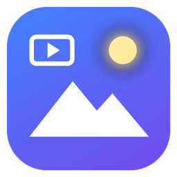

<p align="center"></p>

<h1 align="center">Lumen</h1>
<p align="center"><b>A fast, private, modern image and video viewer for Windows: a FastStone Image Viewer replacement with a built-in video analysis mode.</b><br>
One portable <code>Lumen.exe</code>. No installer, no account, no telemetry.</p>

<p align="center"><a href="https://github.com/RahulTarigoppula/lumen-image-viewer/releases/latest"><b>Download Lumen.exe</b></a></p>

---

## Why Lumen

FastStone Image Viewer is loved for being fast and complete, but it shows its age: a dated UI, tiny previews inside modal edit dialogs, no real video support and no way to remap keys. Lumen keeps what makes FastStone great (the browser and viewer workflow, keyboard-first operation, batch tools) and rebuilds it on a modern, GPU-accelerated engine:

- **Instant on huge images.** A tiled GPU renderer with a mip pyramid shows 100+ megapixel photos and pans and zooms smoothly. Neighbours are preloaded, so stepping through a folder is instant. Folders with thousands of files browse at under 1 ms per frame.
- **Many formats.** JPEG, PNG/APNG, GIF (animated), WebP (animated), TIFF (multi-page), BMP, ICO/CUR, TGA, PNM, QOI, DDS, HDR, OpenEXR, PSD/PSB, SVG, PCX, WMF/EMF and PDF pages natively; HEIC/HEIF, AVIF, JPEG XL, JPEG-XR and camera RAW (DNG, CR2/CR3, NEF, ARW, ORF, RW2, RAF and more) through Windows codecs.
- **Correct color.** Embedded ICC profiles (Adobe RGB, Display P3, ProPhoto) are converted to sRGB, and EXIF orientation is honored everywhere.
- **Live, full-size editing.** Adjustments preview on the real image, hold to compare with the original, unlimited undo. Nothing is modal.
- **Safe by default.** Lossless JPEG rotation, atomic saves that never corrupt originals, unsaved-edit guards, Recycle Bin deletes, undo for move and rename.
- **Video mode.** Frame-accurate stepping, A/B comparison (side by side, wipe, flicker, difference, overlay, checkerboard), PSNR/SSIM per frame and whole-file analysis with CSV export, an I/P/B frame-size timeline, scopes (waveform, RGB parade, vectorscope, histogram) and full media info.
- **Private.** Ratings, flags and labels live in a local file, never written into your photos and never uploaded.

## Features

**Browser**: folder tree with favorites and drives, thumbnail grid with a persistent cache, details view, natural sort by name, size, dates, date taken, dimensions, rating, flag or label, instant filter, flags, 0-5 star ratings and color labels, copy, move, rename and delete, drag files onto folders or out to Explorer, copy and paste files with Explorer, preview pane, type-ahead.

**Viewer**: fit modes (fit large, fit all, fill, width, height, 100%), smooth zoom at the cursor, lock zoom across images, press-and-hold magnifier, animated GIF/WebP/APNG playback with frame stepping, multi-page documents, filmstrip, info panel with histogram, full EXIF and GPS, FastStone-style pop-out panels at the screen edges, full screen with auto-hiding controls, touchpad pinch and pan.

**Editing**: crop with aspect presets, rotate and flip, straighten, resize (Lanczos and more), canvas size, auto enhance, adjust colors (exposure, brightness, contrast, gamma, shadows, highlights, saturation, vibrance, hue, temperature, tint), levels, curves, sharpen, blur, effects gallery, borders and frames, text, watermark, draw board (arrows, shapes, callouts, highlighter, numbered markers), clone stamp, healing brush, red-eye removal, blur or pixelate regions, selection-limited adjustments, save and save as with a live file-size estimate.

**Tools**: batch convert and resize with an ordered pipeline and presets, batch rename with tokens, preview and undo, contact sheets, duplicate and similar-image finder, compare 2-4 images with synced zoom (split, flicker, difference), slideshow with GPU transitions and Ken Burns, multi-page PDF/TIFF/GIF creation, image strips, ZIP archives, metadata tools (JPEG comments, strip metadata, change dates, XMP sidecars), set as wallpaper, print with layouts, command palette (Ctrl+K) for every command.

**Video**: play with audio (A/V synced), `,` and `.` frame stepping in both directions, go to frame or time (G), A-B loop, speed control, compare two encodes with a frame offset, PSNR-Y/U/V and SSIM, whole-file analysis with worst-frame list, scopes, native-resolution snapshots.

**Keyboard**: every shortcut is remappable (Settings, Keyboard), with a FastStone-compatible preset.

## Keyboard highlights

Press **F1** in the app for the full list, or **Ctrl+K** to search every command.

| | Browser | Viewer | Video |
|---|---|---|---|
| Open | Enter or double-click | - | drop files |
| Navigate | arrows, Home/End | Left/Right, Space, PgUp/PgDn, wheel | `,` `.` step, Shift+Left/Right 1 s |
| Zoom | Ctrl+wheel (thumbnail size) | +/-, Ctrl+wheel, Z (100%), `/` (fit) | wheel, 0 fit, 1 100% |
| Rate / flag | 0-5 / Space or Q | 0-5 / Q or `` ` `` | - |
| Edit | - | X crop, Ctrl+E colors, Ctrl+R resize, L/R rotate, T draw board | - |
| Compare | P | P | S W D O C Tab, X swap, +/- offset |

## Install

1. Download **Lumen.exe** from [Releases](https://github.com/RahulTarigoppula/lumen-image-viewer/releases/latest).
2. Run it. It is fully portable. Settings live in `%APPDATA%\Lumen`; create an empty `portable.txt` next to the exe to keep everything beside it instead.
3. Optional: Settings, Windows integration, *Register file types* adds "Open with Lumen" and an Explorer "Browse with Lumen" folder menu (per user, no admin rights).

For HEIC, AVIF and RAW files, install the free Microsoft Store extensions (*HEIF Image Extensions*, *AV1 Video Extension*, *Raw Image Extension*); Lumen picks them up automatically.

## Build from source

Requirements: Rust (stable, MSVC), Visual Studio Build Tools, and for video: vcpkg and libclang.

```powershell
git clone https://github.com/microsoft/vcpkg C:\vcpkg; C:\vcpkg\bootstrap-vcpkg.bat
C:\vcpkg\vcpkg install "ffmpeg[core,avcodec,avformat,swscale,swresample,dav1d]:x64-windows-static-md-rel" --overlay-ports=vcpkg/overlay-ports --overlay-triplets=vcpkg/triplets
$env:VCPKG_ROOT="C:\vcpkg"; $env:VCPKGRS_TRIPLET="x64-windows-static-md-rel"; $env:LIBCLANG_PATH="C:\Program Files\LLVM\bin"
cargo build --release                          # target\release\lumen.exe
cargo build --release --no-default-features    # image-only build without FFmpeg
```

The repository is a Cargo workspace: the `lumen` app at the root and the UI-free `lumen-core` library in `crates/lumen-core`. Run all unit tests with `cargo test --workspace --no-default-features` (no FFmpeg needed).

Design notes: [docs/ARCHITECTURE.md](docs/ARCHITECTURE.md), [docs/VIDEO-RESEARCH.md](docs/VIDEO-RESEARCH.md), and the proposed analysis feature in [docs/ANALYSIS-PLAN.md](docs/ANALYSIS-PLAN.md).

## Privacy

Lumen itself never connects to the internet. Map links for photos with GPS data open in your web browser only when you ask, after a confirmation.

## License

MIT, see [LICENSE](LICENSE) and [THIRD-PARTY-NOTICES.md](THIRD-PARTY-NOTICES.md) (FFmpeg is LGPL-2.1+).
